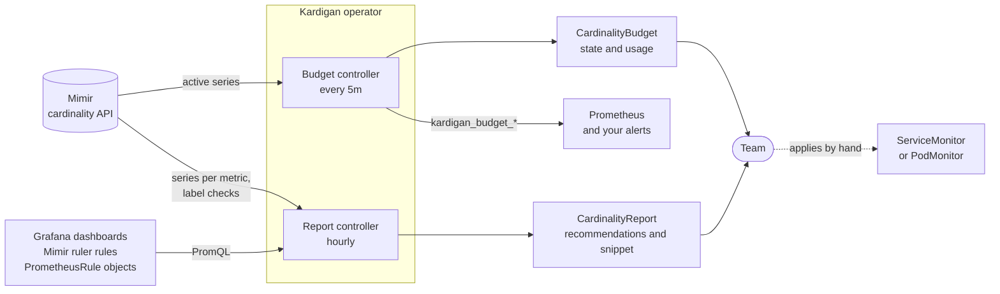

# Kardigan

**Cardinality budgets and recommendations for Grafana Mimir, as a Kubernetes operator.**

Kardigan (cardinality + guardian) gives each team a budget of active series and tells them what to do when they go over it.

- **`CardinalityBudget`** checks a team's active series in Mimir on a schedule, reports `WithinBudget`, `WarningThreshold` or `BudgetExceeded`, and exports metrics so alerting stays in Grafana.
- **`CardinalityReport`** compares the team's metrics with what dashboards and rules actually read, then recommends what to drop, with ready-to-paste relabel config.

Kardigan is observe-only: it never changes how metrics are collected. Teams decide what to apply.

> **Status:** alpha. The API is `v1alpha1` and may change between releases.

## What you get

Create a budget:

```yaml
apiVersion: kardigan.paulgreco.ca/v1alpha1
kind: CardinalityBudget
metadata:
  name: team-c
  namespace: team-c
spec:
  target:
    label: namespace    # or job
    value: team-c
  maxSeries: 10000
  warnAtPercent: 80     # default
  interval: 5m          # default; minimum 30s
```

The examples below are real output from the [local stack](#development), where four synthetic teams send series to Mimir.

### `CardinalityBudget`

```console
$ kubectl get cb -A
NAMESPACE   NAME     TARGET   SERIES   MAX     USAGE%   STATE              AGE
team-a      team-a   team-a   505      1000    50       WithinBudget       3h46m
team-b      team-b   team-b   2005     2200    91       WarningThreshold   3h46m
team-c      team-c   team-c   15755    10000   157      BudgetExceeded     3h46m
```

### `CardinalityReport`

Kardigan creates a report for each budget, with the same name and namespace:

```console
$ kubectl get crpt -A
NAMESPACE   NAME     BUDGET   SERIES   SAVINGS   READY   GENERATED
team-a      team-a   team-a   505      350       True    15s
team-b      team-b   team-b   2005     1600      True    21s
team-c      team-c   team-c   15755    8850      True    21s
```

`SAVINGS` is how many series the relabel snippet would remove. The report's status explains each recommendation (shortened here to one of each kind this team gets):

```console
$ kubectl get crpt team-c -n team-c -o yaml
```

```yaml
spec:
  budgetRef: team-c
status:
  totalSeries: 15755
  potentialSavings: 8850
  generatedAt: "2026-11-03T04:24:22Z"
  conditions:
  - type: Ready
    status: "True"
    reason: AnalysisSucceeded
  - type: UsageComplete
    status: "True"
    reason: AllExpressionsParsed
    message: 6 expressions read
  recommendations:
  - action: DropMetric
    metric: avalanche_histogram_metric_mmmmm_0_1_bucket
    seriesSaved: 1650
    confidence: Medium
    reason: Not in any of 6 expressions from grafana, mimir-ruler, prometheusrules.
      Ad hoc queries aren't visible.
  - action: FixLabel
    metric: avalanche_histogram_metric_mmmmm_0_0_bucket
    label: series_id
    seriesSaved: 1639
    confidence: Low
    reason: Nothing uses this label and it has 150 values. Without it, 1650 series
      become 11, which relabelling would make collide, so remove it in the instrumentation.
  - action: Keep
    metric: avalanche_histogram_metric_mmmmm_0_0_bucket
    seriesSaved: 0
    reason: Used in a dashboard or rule.
```

The snippet is ready to review and paste into a `ServiceMonitor` or `PodMonitor` endpoint (regex shortened here):

```console
$ kubectl get crpt team-c -n team-c -o jsonpath='{.status.relabelSnippet}'
# Kardigan recommendations for team-c, 2026-11-03. Saves ~8850 series.
metricRelabelings:
- action: drop
  regex: avalanche_gauge_metric_mmmmm_0_10|avalanche_gauge_metric_mmmmm_0_11|avalanche_gauge_metric_mmmmm_0_12
  sourceLabels:
  - __name__
```

Team-d gets the other two kinds of advice: it has 21 histogram buckets, and a `pod_uid` label that copies `series_id`:

```yaml
  - action: TrimHistogram
    metric: avalanche_histogram_metric_mmmmm_0_0_bucket
    seriesSaved: 120
    confidence: Low
    reason: Has 21 buckets, and about 15 are usually enough. Use fewer at the source,
      or native histograms.
  - action: DropLabel
    metric: avalanche_gauge_metric_mmmmm_0_0
    label: pod_uid
    seriesSaved: 0
    confidence: Medium
    reason: Nothing uses this label and it has 20 values, but other labels already
      identify each series. Removing it merges nothing and saves no active series.
```

Its snippet removes the label from only the metrics that were checked (regexes shortened here):

```console
$ kubectl get crpt team-d -o jsonpath='{.status.relabelSnippet}'
# Kardigan recommendations for team-d, 2026-11-03. Saves ~520 series.
metricRelabelings:
- action: drop
  regex: avalanche_gauge_metric_mmmmm_0_2|avalanche_histogram_metric_mmmmm_0_1_bucket
  sourceLabels:
  - __name__
- action: replace
  regex: avalanche_gauge_metric_mmmmm_0_0|avalanche_histogram_metric_mmmmm_0_0_bucket
  replacement: ""
  sourceLabels:
  - __name__
  targetLabel: pod_uid
```

Check for ad hoc queries before dropping a metric: Kardigan can only see dashboards and rules.

## Install

You need:

- A Mimir with `limits.cardinality_analysis_enabled: true`, and a Prometheus or agent that sends it the series you want to budget.
- Optionally, a Grafana service account token with read-only access to every dashboard. Without it, reports only check rules, and their recommendations have low confidence.

With Helm:

```bash
kubectl create namespace kardigan-system
kubectl create secret generic grafana-token -n kardigan-system --from-literal=token=<token>

helm install kardigan oci://ghcr.io/pwgreco/charts/kardigan \
  --namespace kardigan-system \
  --set mimir.url=http://mimir-gateway.mimir.svc:8080 \
  --set mimir.tenant=my-tenant \
  --set grafana.url=http://grafana.monitoring.svc \
  --set grafana.tokenSecret.name=grafana-token
```

The [chart's README](charts/kardigan/README.md) lists its values. To manage every team's budget from one namespace, add `--set 'budgetAdminNamespaces={sre}'`.

Without Helm, apply `install.yaml` from a [release](https://github.com/pwgreco/kardigan/releases) and tell the operator where Mimir and Grafana are:

```bash
kubectl apply -f https://github.com/pwgreco/kardigan/releases/latest/download/install.yaml
kubectl -n kardigan-system patch deployment kardigan-controller-manager --type=json -p '[
  {"op": "add", "path": "/spec/template/spec/containers/0/args/-", "value": "--mimir-url=http://mimir-gateway.mimir.svc:8080"},
  {"op": "add", "path": "/spec/template/spec/containers/0/args/-", "value": "--mimir-tenant=my-tenant"},
  {"op": "add", "path": "/spec/template/spec/containers/0/args/-", "value": "--grafana-url=http://grafana.monitoring.svc"},
  {"op": "add", "path": "/spec/template/spec/containers/0/env/-", "value":
    {"name": "GRAFANA_TOKEN", "valueFrom": {"secretKeyRef": {"name": "grafana-token", "key": "token"}}}}
]'
```

Then create some budgets:

```bash
kubectl apply -f https://raw.githubusercontent.com/pwgreco/kardigan/main/config/samples/namespace-budgets.yaml
kubectl get cb,crpt -A
```

That sample targets namespaces `team-a`, `team-b` and `team-c`, which must exist.

## How it works



**Budgets:**

1. A `CardinalityBudget` names a target (a `job` or `namespace` label value) and a `maxSeries`.
2. Every `interval` (default 5m), Kardigan asks Mimir's cardinality API how many active series match.
3. It writes the count, usage percentage and conditions to the budget's status, and exports `kardigan_budget_usage_ratio`, `kardigan_budget_series` and `kardigan_budget_max_series`.
4. You alert on `kardigan_budget_usage_ratio > 1` in Grafana or the Mimir ruler.

**Reports:**

1. Hourly, Kardigan parses the PromQL in Grafana dashboards, Mimir ruler rules and `PrometheusRule` objects, to learn which metrics and labels are read.
2. It compares that with the target's metrics in Mimir, largest first.
3. It writes up to 25 recommendations to the report, with a relabel snippet for the ones relabelling can carry out.

| Action | Meaning | Confidence | In the snippet? |
| --- | --- | --- | --- |
| `DropMetric` | Nothing reads the metric | Medium, or Low if a regex could match it, an expression failed to parse, or Grafana isn't configured | Yes |
| `DropLabel` | Nothing reads the label, and series stay distinct without it. Saves no active series, but shrinks the index | Medium | Yes |
| `FixLabel` | Nothing reads the label and it drives the series count, but removing it would merge series | Low | No, change the instrumentation |
| `TrimHistogram` | A used histogram has more than 15 buckets | Low | No, change the instrumentation |
| `Keep` | Something reads the metric | None | No |

| Condition | On | Meaning |
| --- | --- | --- |
| `Ready` | Both | The last check or analysis succeeded |
| `WithinBudget` | Budget | Below `maxSeries`; the reason gives the state |
| `UsageComplete` | Report | Every expression parsed, and Grafana was checked |

## Repository map

| Path | What |
| --- | --- |
| [`HANDOFF.md`](HANDOFF.md) | Project state, design, roadmap, decisions and gotchas |
| [`CONTRIBUTING.md`](CONTRIBUTING.md), [`SECURITY.md`](SECURITY.md) | How to run the checks, and how to report a vulnerability |
| [`CLAUDE.md`](CLAUDE.md) | Conventions for AI coding assistants |
| [`hack/local-stack/`](hack/local-stack/docker-compose.yaml) | Mimir, Prometheus, Grafana and four synthetic teams in Docker Compose |
| [`hack/kind/`](hack/kind/) | In-cluster workloads, a Prometheus agent, and a Prometheus Operator test for kind |
| [`charts/kardigan/`](charts/kardigan/README.md) | The Helm chart |
| `api/` | The `CardinalityBudget` and `CardinalityReport` types |
| `internal/controller/` | The two controllers |
| `internal/mimir/`, `internal/grafana/` | Clients for Mimir's cardinality and ruler APIs, and Grafana's dashboards |
| `internal/usage/`, `internal/recommend/` | PromQL usage extraction, scoring and the relabel snippet |
| `cmd/`, `config/` | The operator's entry point and Kustomize manifests |

## Development

Requirements: Go 1.26+, Docker, kind, kubectl, kubebuilder 4.16+.

```bash
# Local Mimir, Prometheus, Grafana (:9000) and four noisy teams
(cd hack/local-stack && docker compose up -d)

# A cluster with the CRDs and sample budgets
kind create cluster --name kardigan
make install && kubectl apply -k config/samples/

# Run the operator against the local stack
go run ./cmd/main.go --mimir-url=http://localhost:9009 --mimir-tenant=demo \
  --grafana-url=http://localhost:9000 \
  --metrics-bind-address=:8080 --metrics-secure=false

make test     # unit and envtest
make lint
make verify   # everything CI checks, except the image scan and e2e

# Against real Mimir and Grafana, which starts the stack for you
make test-integration   # the clients, and a comparison with mimirtool
make test-stack         # the deployed operator, in a throwaway kind cluster
make test-all           # those, plus the chart, a snippet on a real scrape, and release artefacts
```

`make verify` runs every fast check, and `make ci` adds the image scan and e2e tests. See [CONTRIBUTING.md](CONTRIBUTING.md). To give reports something to find, load the demo dashboard:

```bash
jq '{dashboard: ., overwrite: true}' hack/local-stack/dashboards/team-c-demo.json |
  curl -s -X POST -H 'Content-Type: application/json' --data @- http://localhost:9000/api/dashboards/db
```

## FAQ

### Install

#### Does Kardigan work without Mimir?

No. It reads Mimir's cardinality API, which plain Prometheus doesn't have. Prometheus only needs to send Mimir the series.

#### Do I need the Prometheus Operator?

No. If the `PrometheusRule` CRD exists, Kardigan reads those objects too. Otherwise it treats them as absent, and picks them up if the CRD appears later. The snippet uses the Operator's field names, so for a plain Prometheus config, change them to `source_labels`, `target_label` and so on under `metric_relabel_configs`.

#### Do I need Grafana?

No, but it's strongly recommended. Without `grafana.url`, only rules are checked, every `DropMetric` has low confidence, and `UsageComplete` is `False` with reason `DashboardsNotChecked`. If there are no rules either, reports don't recommend anything, because every metric would look unused.

#### What permissions does it need?

A ClusterRole that can read budgets and update their status, manage reports, and list `PrometheusRule` objects, plus a lease for leader election. It has no access to `ServiceMonitor`, `PodMonitor` or collector config. For people, the chart adds `<release>-budget-editor` and `<release>-budget-viewer` ClusterRoles.

#### Can one install serve several Mimir tenants?

No. An install reads one tenant, and two installs in a cluster would both reconcile every budget.

#### How do I upgrade?

`helm upgrade` updates the operator, its RBAC and the CRDs. `helm uninstall` leaves the CRDs and budgets in place. See [CRD lifecycle](charts/kardigan/README.md#crd-lifecycle).

### Using it

#### Can SRE manage every team's budget from one namespace?

Yes. Run the operator with `--budget-admin-namespaces=sre`, and budgets in `sre` can target any namespace. Budgets elsewhere can only target their own namespace, and otherwise report `Ready=False, Reason=CrossNamespaceTarget` and get no report. Metrics carry the budget's namespace, which here is `sre`, so route alerts on `target_value`.

#### Can a team see another team's metric names?

Through a namespace target, no, unless the budget is in an admin namespace. Through a `job` target, yes: a job label has no owning namespace, so any namespace can create that budget, and its report lists the job's metric names. Limit who can create budgets with RBAC if that matters.

#### Why is a recommendation low confidence?

Its reason says why. For `DropMetric`, it's one of: a selector with a regex or template variable could read the metric, some expressions couldn't be parsed, or Grafana isn't configured. `FixLabel` and `TrimHistogram` are always low, since they need a change at the source and a person's judgement.

#### Is a metric marked `DropMetric` definitely safe to drop?

No. Kardigan can't see ad hoc queries, Grafana-managed alert rules, library panels, or anything outside Grafana and the rules it reads. Check with the team first.

#### Why does a metric show as `Keep` when my team never uses it?

Usage is matched by metric name, not by team. If another team's dashboard reads a metric with the same name, your copy counts as used too. That can miss a saving, but it can't suggest a wrong drop.

#### Why does the report list only 25 entries, when more metrics are unused?

Recommendations are capped at 25, with room for up to 5 `Keep` entries, so reports stay readable. `SAVINGS` only counts what's listed. Apply a batch, and the next report shows the next largest.

#### Why doesn't dropping a label save any series?

Because of what makes dropping one safe. If series stay distinct without the label, they all survive, so the count doesn't change. If the count would fall, some series have become identical, and Prometheus keeps one and silently loses the others' samples, with no error or failed target. So `DropLabel` reports `seriesSaved: 0`, and a label that really drives the count is a `FixLabel`, to change in the instrumentation.

#### Why does the snippet use `replace` to remove a label, not `labeldrop`?

`labeldrop` can't name a metric, so it would remove the label from everything in the scrape, including metrics where nothing checked that series stay distinct. Setting the label to an empty value removes it, and `sourceLabels` limits that to the metrics concerned.

#### Why does a report still list what I just dropped?

Mimir counts a series as active for 20 minutes after its last sample, by default, and reports run hourly. So a report can take up to about 80 minutes to catch up. To check sooner, wait out Mimir's 20 minutes, then regenerate the report. `scrape_samples_post_metric_relabeling` shows the effect straight away.

#### How do I regenerate a report now?

Delete it, and it comes back straight away: `kubectl delete crpt team-c -n team-c`. Editing the budget's spec also triggers one. The schedule is `reportInterval` in the chart, or `--report-interval`.

#### What happens when Mimir or Grafana is down?

Budgets set `Ready=False` and retry every minute. Reports set `Ready=False`, keep their last good recommendations, and retry every 5 minutes. They don't carry on with partial data, because a metric in a dashboard Kardigan couldn't read isn't unused. The condition's message gives only a short summary, and the error itself is in the operator's log, because people who can read a budget may not be allowed to see Mimir's address or what it answered.

### Limitations and impact

#### Does Kardigan ever change my metrics?

No. It's observe-only: the snippet is text in a report's status, and teams apply it by hand.

#### How much load does it put on Mimir?

A budget makes one query per `interval`, which can't be below 30s. A report makes, hourly, one query for its metrics, then for up to 10 used metrics, one query for their labels and three per unused label with 10 or more values. They run one at a time, because parallel queries get HTTP 429 even on a small Mimir. Dashboards and rules are fetched once per interval, and shared by all budgets.

#### Are there limits on what it reads from Mimir and Grafana?

Yes. A Mimir response over 32 MiB, a Grafana response over 16 MiB, or more than 100 pages of Grafana dashboards fails the check, and sets `Ready=False`. Kardigan doesn't carry on without them, because a metric in a dashboard it couldn't read isn't unused.

## Licence

Apache-2.0. See [LICENSE](LICENSE).
